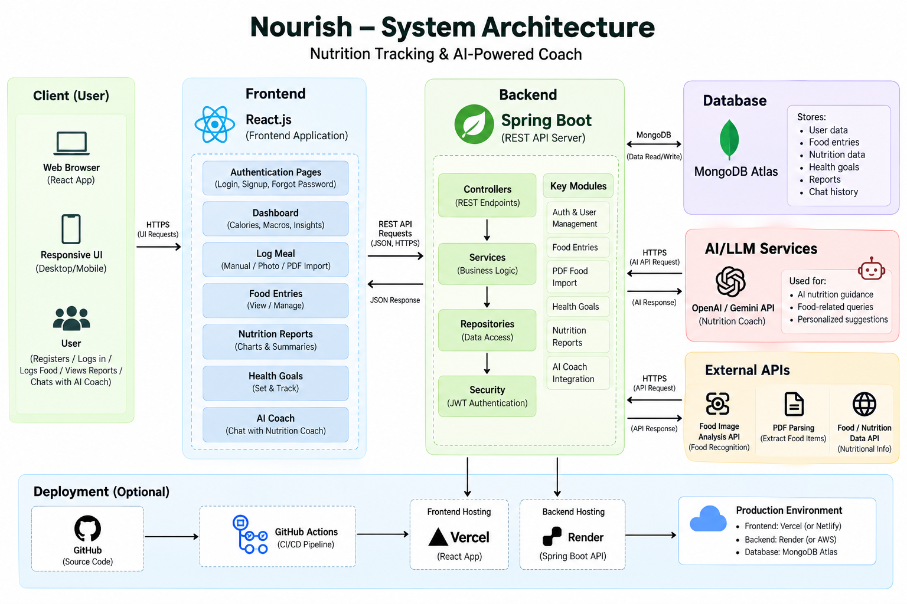

# 🥗 Nourish — Personal Calorie Tracker 

<p align="center">
  <strong>Eat well. Feel your best.</strong>
</p>

Nourish is a full-stack nutrition tracking application designed to help users log meals, monitor calorie intake and macronutrients, set personalized health goals, and visualize nutrition trends with AI-powered assistance.

## 🌐 Live Application

- **Live Website:** [Nourish](https://nourish-frontend-phi.vercel.app/)
- **Backend:** [Nourish API](https://nourish-back.onrender.com)
- **GitHub:** [Source Code](https://github.com/Deepikakolli4/Nutrino)
- **Demo Video:** [Watch Nourish Demo](docs/nourish-demo.mp4)

## ✨ Features

- **Authentication:** User registration, login, and JWT-based authentication.
- **Meal Tracking:** Record meals by category, quantity, and nutritional values.
- **Health Goals:** Set daily calorie, protein, carbohydrate, fat, and weight targets.
- **Nutrition Reports:** Visualize nutrition trends and compare intake against goals.
- **AI Nutrition Coach:** Conversational assistance for nutrition-related questions.
- **Food Image Analysis:** Planned support for extracting nutritional information from food images and labels.
- **PDF Import:** Planned support for importing food diaries and nutrition history from PDF documents.
- **Responsive Interface:** Dedicated dashboards and navigation for nutrition management.

## 🛠️ Technology Stack

| Layer | Technologies |
|---|---|
| Frontend | React.js, JavaScript, HTML, CSS |
| Build & Routing | Webpack, Babel, React Router |
| Backend | Java, Spring Boot, Spring Security |
| Database | MongoDB Atlas |
| Authentication | JWT |
| API & Visualization | REST APIs, Axios, Recharts |
| AI Integration | OpenAI / Gemini APIs |
| Deployment | Vercel, Render |
| Version Control | Git, GitHub |

## 🏗️ System Architecture

Nourish follows a client-server architecture integrating the frontend, backend REST API, database, AI services, external APIs, and deployment infrastructure.

<p align="center">
  
</p>

## 🚀 Getting Started

### Prerequisites

- Java 22
- Node.js and npm
- MongoDB Atlas account or a compatible MongoDB instance

### 1. Clone the Repository

```bash
git clone https://github.com/Deepikakolli4/Nutrino.git
cd Nutrino
```

### 2. Start the Backend

```bash
cd CalTrac
./mvnw spring-boot:run
```

On Windows, use:

```powershell
.\mvnw.cmd spring-boot:run
```

Configure the required MongoDB connection, JWT settings, and external service credentials before starting the backend.

### 3. Start the Frontend

Open a separate terminal from the repository root:

```bash
cd frontend
npm install
npm run dev
```

The development server runs at `http://localhost:3000`.

### Production Build

```bash
npm run build
```

Webpack generates the production files in `frontend/dist/`.

## 🚢 Deployment

| Component | Platform |
|---|---|
| Frontend | Vercel |
| Backend | Render |
| Database | MongoDB Atlas |

Configure production environment variables, database connectivity, authentication settings, and CORS origins before deployment. Never commit secrets or API keys to source control.

## 🔮 Future Enhancements

- AI-powered food image and nutrition-label analysis.
- Bulk food diary import from PDF documents.
- Advanced nutrition insights and personalized recommendations.
- Expanded automated testing and API documentation.

## 📄 License

No license is currently specified. Add a `LICENSE` file if you intend to distribute the project under a particular open-source license.
